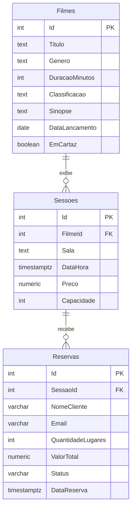

# Banco cinema

As chaves são inteiras geradas pelo banco. A FK de filme usa RESTRICT. A FK de reserva usa CASCADE. Há índices nas FKs e em sala e horário. Preço e valor total usam numeric(10,2). Sinopse é opcional. Datas de lançamento representam dias civis. Os instantes de reserva e sessão são UTC.

As três primeiras migrations criam as tabelas e inserem seus exemplos. Na criação da tabela de sessões, os horários de demonstração são deslocados juntos se necessário. Instalações que já aplicaram essa migration conservam seus horários. A quarta migration verifica se há sessões superlotadas e instala checks para duração, preço, capacidade, quantidade e status. Uma violação interrompe a atualização e exige revisão dos dados existentes.
